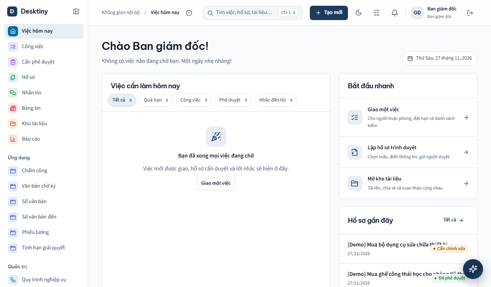
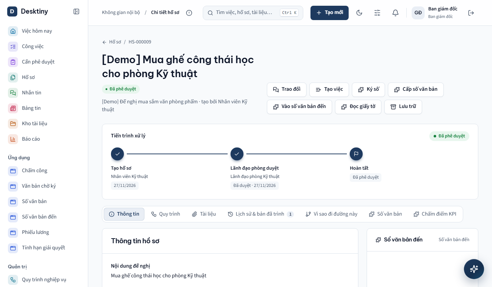
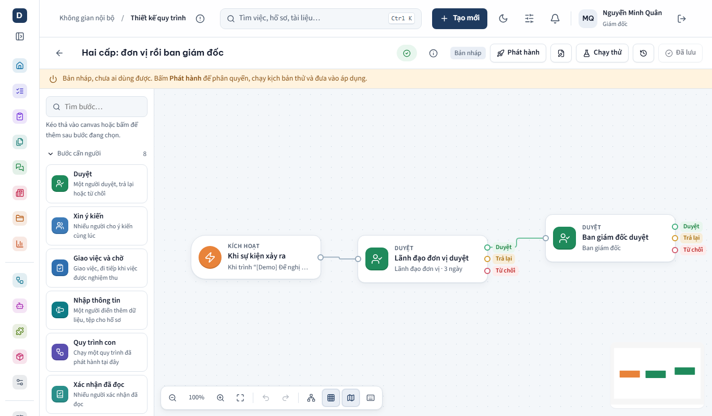
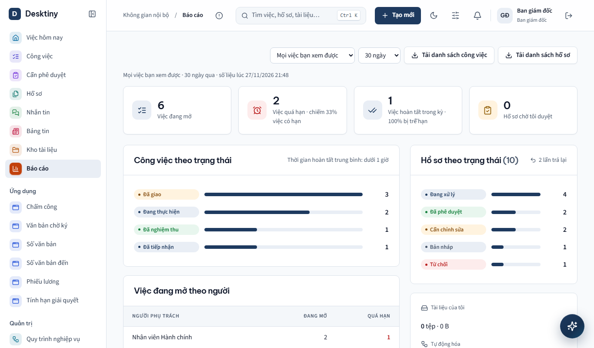
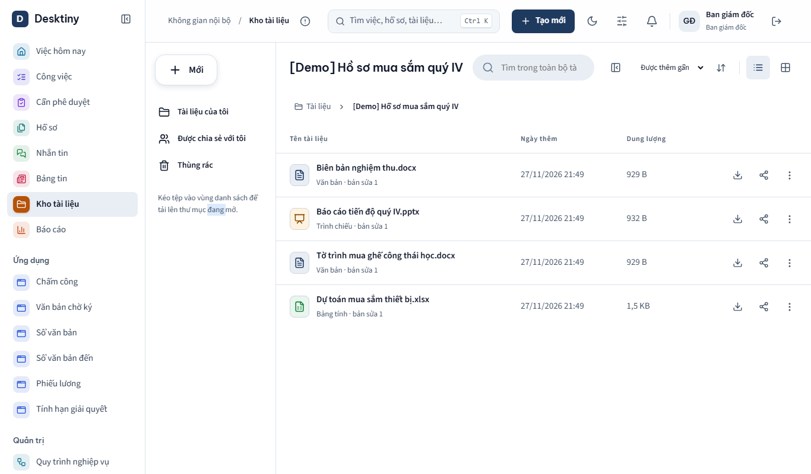
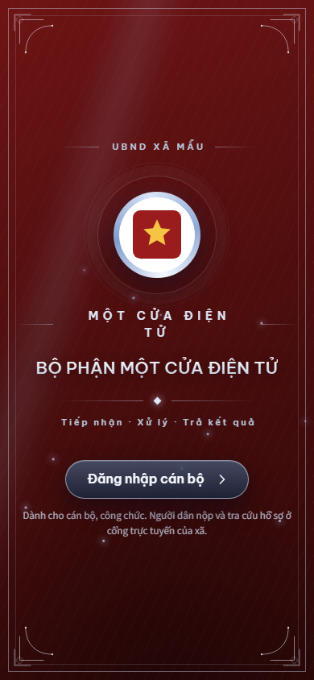
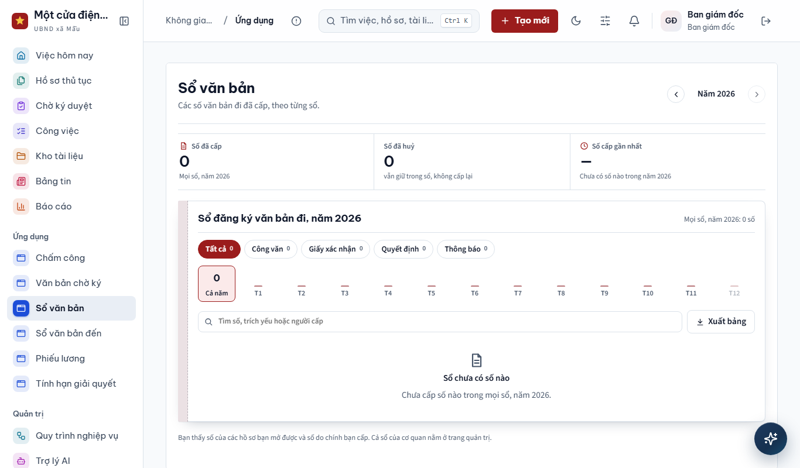

# Desktiny

**Văn phòng số mã nguồn mở cho cơ quan và doanh nghiệp: giao việc, trình duyệt hồ sơ, quy trình tự thiết kế và
tài liệu trên một Core dùng chung, mở rộng sang nghiệp vụ mới bằng cách cài gói.**

[](https://github.com/Dking2007/DXOS_Desktiny/releases)
[](LICENSE)
[](https://github.com/Dking2007/DXOS_Desktiny/actions/workflows/ci.yml)
[](https://api.reuse.software/info/github.com/Dking2007/DXOS_Desktiny)

*Desk + destiny.* Tên cũ: DX Workspace; tên nội bộ trong mã nguồn, cơ sở dữ liệu và container vẫn là
`dx_workspace` / `dx-workspace`. English: [README_EN.md](README_EN.md).

> Đây là bản pilot. Compose trong repo là cấu hình phát triển, không phải cấu hình production. Kết quả nghiệm thu
> và những bước còn cần dịch vụ thật ghi ở [docs/acceptance.md](docs/acceptance.md).

## Bài toán và lời giải

Mỗi phòng ban dùng một phần mềm riêng thì dữ liệu thành **ốc đảo**: tài khoản, hồ sơ, tệp và lịch sử xử lý nằm rải
rác, khó tra và khó nối với nhau. Gom tất cả vào một hệ thống nguyên khối thì khó sửa, mỗi nghiệp vụ mới là một lần
viết lại và dễ bị khóa vào một nhà cung cấp. Desktiny tách một **Core headless dùng chung** (định danh, dữ liệu,
tệp, quy trình, nhật ký kiểm toán) khỏi các ứng dụng chạy trên nó. Thêm nghiệp vụ mới là **cài một gói**, không
phải viết lại hệ thống.

## Dùng thử

Cần Docker Compose v2, Python 3.13 và cổng `8080` còn trống. Chạy ở thư mục gốc repo:

```bash
python scripts/bootstrap.py
docker compose --env-file .env -f infra/compose/compose.yaml --profile workspace up --build -d
python scripts/seed.py --confirm-demo
python scripts/seed_demo.py --confirm-demo   # nội dung minh họa (tùy chọn)
```

Mở <http://localhost:8080/>. Tài khoản dùng thử nằm trong `infra/identity/generated/demo-credentials.txt` trên máy
của bạn: bootstrap sinh mật khẩu ngẫu nhiên tại chỗ, repo không chứa mật khẩu cố định. Seed tạo dữ liệu giả có ghi
nhãn. Bật ONLYOFFICE, đổi cổng hay chỉ chạy Core: xem [Cài đặt](#cài-đặt).

## Tính năng chính

| Việc cần làm | Desktiny có |
|---|---|
| Giao việc và theo dõi tới khi xong | Giao cho người hoặc đơn vị; việc con, checklist; trả lại, báo vướng, đổi hạn đều cần lý do và ghi lịch sử. Xem dạng danh sách, Kanban, nhóm theo hạn; trang chủ là *Việc cần làm hôm nay* |
| Trình và duyệt hồ sơ | Biểu mẫu có trường ẩn/hiện theo điều kiện; duyệt, trả lại, từ chối, xin ý kiến song song; ủy quyền phê duyệt có thời hạn; thu hồi hồ sơ khi chưa ai quyết định; tab *Quy trình* cho biết hồ sơ đang chờ ai |
| Tự thiết kế quy trình, không viết mã | Trình thiết kế dạng canvas kéo thả: điều kiện, chờ, thông báo, tạo việc, webhook, bước duyệt. Chạy thử với dữ liệu mẫu, xem lại từng lượt chạy trên canvas; hồ sơ đi theo phiên bản quy trình đã phát hành |
| Quản lý tài liệu | Kho tài liệu có thư mục, chia sẻ kế thừa theo thư mục, phiên bản, nhãn, sao chép; xem PDF, ảnh, video ngay trong ứng dụng; mở tệp Office bằng ONLYOFFICE (tùy chọn) |
| Trao đổi, tìm và báo cáo | Nhắn tin riêng, nhóm, kênh phòng ban kèm ảnh, video, tệp; bảng tin toàn tổ chức hoặc phòng ban; tìm kiếm chung gõ không dấu vẫn ra ("bao cao" tìm thấy "Báo cáo") và chỉ trả kết quả người tìm được xem; báo cáo việc quá hạn, hồ sơ theo trạng thái, xuất CSV |
| Trợ giúp bằng AI (tùy chọn, mặc định tắt) | Trợ lý trả lời từ kho kiến thức do quản trị nhập; 19 tính năng AI bật riêng từng cái (đọc tài liệu điền sẵn biểu mẫu, tóm tắt hồ sơ, soạn văn bản theo Nghị định 30/2020, tìm theo ý nghĩa…). AI chỉ đề xuất, không tự trình, duyệt hay gửi đi. Cần dịch vụ AI do tổ chức tự cấu hình |

<p>
  
  
</p>
<p>
  
  
</p>
<p>
  
  
</p>

Mô tả đầy đủ từng tính năng và phạm vi hiện tại: [docs/tinh-nang.md](docs/tinh-nang.md). Tính năng AI:
[docs/ai-features.md](docs/ai-features.md).

## Bản mở rộng

Repo [Desktiny Expansion Pack](https://github.com/Dking2007/Desktiny_expansion_pack) chứa các **bản mở rộng**: mỗi
bản gồm một [gói giao diện](docs/packs.md) (từ ngữ, màu, quy trình, biểu mẫu, kiến thức cho trợ lý) và các
[plugin](docs/plugins.md). Quản trị viên cài các tệp `.zip` ở **Quản trị › Gói giao diện** và **Quản trị › Plugin**
để chuyển Desktiny sang một nghiệp vụ khác mà không sửa mã Core. Plugin kết nối chạy trên máy chủ plugin riêng
(Docker Compose có sẵn trong repo đó).

| Bản mở rộng | Dành cho | Plugin đi kèm |
|---|---|---|
| **Một cửa cấp xã** | Bộ phận một cửa của UBND cấp xã: thủ tục hộ tịch, chứng thực, hòa giải | Sổ văn bản, Ký số, Tiếp nhận trực tuyến, Tính hạn, Đọc giấy tờ |
| **Nhân sự doanh nghiệp** | Bộ phận nhân sự: quy trình đơn từ, quy chế cho trợ lý | Chấm công GPS, Tiền lương và KPI, Nhắc hạn hồ sơ |
| **Văn thư – điều hành** | Văn thư, văn phòng: văn bản đến, văn bản đi, nộp lưu | Sổ văn bản đến; dùng chung Sổ văn bản, Ký số, Tính hạn |

Đây là bản mẫu: tên cơ quan là tên giả, thời hạn và mức tiền chỉ để minh họa, ký số là mô phỏng. **Tương thích:**
bản mở rộng 1.1.0 cần Desktiny **3.1.0** trở lên.



## Kiến trúc

Viết bằng **FastAPI + Vue 3 / TypeScript**, theo mô hình hai tầng của đề thi OLP PMNM 2026 (DX-OS Open-Core):

| Tầng | Thành phần | Quyền sở hữu |
|---|---|---|
| Tầng 1 — Core headless (không có giao diện, chỉ API) | `core-api` (FastAPI), `core-worker`, Keycloak, cổng API Nginx, PostgreSQL, RustFS, Valkey | Principal/ACL, schema/record, storage/version, workflow, audit |
| Tầng 2 — Ứng dụng có giao diện | Workspace: `workspace-api`, `workspace-worker`, web Vue | Tổ chức, Drive, form, hồ sơ, submission, quyết định |
| Tầng 2 — Công cụ quản trị kỹ thuật | Core admin (`apps/core-admin`, `/console/`) | Chỉ là một client của Core API, không chứa logic Core |
| Tích hợp tùy chọn | ONLYOFFICE Docs | Editor chạy riêng |

Core không phục vụ trang giao diện nào: mọi chức năng đi qua API `/core/v1/` (OpenAPI tại `/core/v1/docs`). Không
dùng chung ORM hay SQL xuyên database; Core vẫn phục vụ client khác khi Workspace tắt (ví dụ
[`examples/core-client`](examples/core-client)). Theo nhóm H-P-D-I của đề, Workspace phủ **H** (giao việc, trao
đổi), **P** (hồ sơ, phê duyệt, quy trình), **D** (báo cáo, một phần) và **I** (tính năng AI tùy chọn, mặc định tắt).
Chi tiết: [docs/architecture.md](docs/architecture.md).

## Cài đặt

Hướng dẫn đầy đủ (Ubuntu/Windows, Docker và chạy cục bộ): [docs/installation.md](docs/installation.md). Biên dịch từ
mã nguồn và cài bằng `make`: [BUILD.md](BUILD.md).

<details>
<summary>Đổi cổng, bật ONLYOFFICE, chỉ chạy Core</summary>

- **Đổi cổng:** chạy bootstrap ngay từ đầu với `python scripts/bootstrap.py --base-url http://localhost:8090`.
  Bootstrap từ chối ghi đè cấu hình đã có; không dùng nó để provision production.
- **ONLYOFFICE:** đổi `ONLYOFFICE_ENABLED=true` trong `.env`, rồi chạy
  `docker compose --env-file .env -f infra/compose/compose.yaml --profile workspace --profile office up -d`.
  Chờ Document Server sẵn sàng rồi mở tài liệu từ Kho tài liệu. Khi chưa bật, editor không hoạt động.
- **Chỉ Core:** `docker compose --env-file .env -f infra/compose/compose.yaml --profile core up --build -d`, rồi
  mở `/console/`. Client `core-example` dùng namespace `equipment`, secret `CORE_EXAMPLE_CLIENT_SECRET` trong `.env`.

</details>

<details>
<summary>Phát triển local và kiểm thử</summary>

Cần Python 3.13 và Node.js 22. Backend vẫn cần PostgreSQL, Keycloak và S3 cho tích hợp thật.

```bash
python -m venv .venv            # rồi kích hoạt: .venv/Scripts/activate (Windows) hoặc .venv/bin/activate
python -m pip install -r requirements-dev.txt
npm ci
# Mỗi backend chạy từ thư mục service, DATABASE_URL riêng:
#   services/core-api:      python -m alembic upgrade head && python -m uvicorn dx_core.main:app --port 8001
#   services/workspace-api: python -m alembic upgrade head && python -m uvicorn dx_workspace.main:app --port 8002
npm run dev --workspace apps/workspace-web
```

```bash
python -m ruff check packages services scripts tests examples infra
python -m pytest -q
npm run lint && npm run typecheck && npm run test && npm run build
```

Test doubles kiểm được logic nhưng không thay nghiệm thu khóa PostgreSQL, SSO, Office thật hay cài sạch. Chi tiết:
[docs/installation.md](docs/installation.md), [docs/acceptance.md](docs/acceptance.md).

</details>

## Giới hạn

- **Pilot:** Compose trong repo là cấu hình phát triển, không phải production; chưa cam kết hiệu năng, RPO/RTO khi
  chưa đo.
- **Một tổ chức** mỗi bản triển khai; chưa có SaaS đa tổ chức, chưa hỗ trợ một người thuộc nhiều đơn vị.
- **Chưa có chữ ký số có giá trị pháp lý.** Quyền phê duyệt và nhật ký kiểm toán không thay chữ ký số; plugin Ký số
  trong bản mở rộng Một cửa là mô phỏng.
- **Chưa có ứng dụng di động native**; trên điện thoại dùng bản web.
- **Chưa quét antivirus/mã độc** tệp tải lên; hiện chỉ kiểm định dạng, chữ ký nội dung và giới hạn kích thước.
- **AI cần dịch vụ bên ngoài** (Claude, OpenAI, Gemini, DeepSeek) hoặc máy chủ AI riêng (Ollama, vLLM) do tổ chức
  cấu hình. Đã kiểm bằng dịch vụ giả và một lần chạy thật với Ollama (31/10/2026); chưa thử với Claude, OpenAI,
  Gemini thật.
- Nhắn tin và thông báo cập nhật bằng polling, chưa có WebSocket; công việc chưa có Gantt hay lịch tháng; luồng tự
  động chưa có node vòng lặp hay connector OAuth2. Phạm vi từng tính năng: [docs/tinh-nang.md](docs/tinh-nang.md).

## Tài liệu

- [Cài đặt](docs/installation.md) · [Biên dịch](BUILD.md) · [Vận hành, backup, restore](docs/operations.md) ·
  [Bảo mật](docs/security.md)
- [Tính năng chi tiết](docs/tinh-nang.md) · [Tính năng AI](docs/ai-features.md) · [Kịch bản demo](docs/demo.md)
- [Quy trình nghiệp vụ, chạy thử và truy vết](docs/process-packages.md) · [Gói giao diện](docs/packs.md) ·
  [Plugin](docs/plugins.md)
- [Kiến trúc](docs/architecture.md) · [Thiết kế gốc](docs/design/Thiet_ke_DX_Workspace_FastAPI_Vue3.md) ·
  [Inventory bên thứ ba](docs/third-party-inventory.md)
- [CHANGELOG](CHANGELOG.md); bản hiện tại là **V3.1 (3.1.0)**. V3 khác V2: [docs/V3_CHANGES.md](docs/V3_CHANGES.md);
  V2 khác V1: [docs/V2_CHANGES.md](docs/V2_CHANGES.md).

## Đối chiếu đề thi

Đối chiếu từng yêu cầu của đề thi OLP PMNM 2026 với mã nguồn: [docs/doi-chieu-de-thi.md](docs/doi-chieu-de-thi.md).
Tự rà soát theo tiêu chí PoF: [SELF_REVIEW.md](SELF_REVIEW.md).

## Biên dịch, phát hành và đóng góp

- Báo lỗi, đề xuất: <https://github.com/Dking2007/DXOS_Desktiny/issues>.
- Bản phát hành (`.tar.gz` kèm `SHA256SUMS`): <https://github.com/Dking2007/DXOS_Desktiny/releases>.
- Cách đóng góp: [CONTRIBUTING.md](CONTRIBUTING.md), [CODE_OF_CONDUCT.md](CODE_OF_CONDUCT.md); báo lỗ hổng bảo
  mật: [SECURITY.md](SECURITY.md).

### Đóng góp ngược cho cộng đồng nguồn mở

Trạng thái thật tại thời điểm ghi (30/10/2026); từng bước, link và kết quả ở
[docs/contribution-log.md](docs/contribution-log.md).

| Việc | Dự án nhận | Trạng thái |
|---|---|---|
| Bổ sung 2 ghi chú còn thiếu cho mục "Migrating to 26.7.5" của hướng dẫn nâng cấp | Keycloak: issue [#53650](https://github.com/keycloak/keycloak/issues/53650), PR [#54464](https://github.com/keycloak/keycloak/pull/54464) | Đã gửi 30/10/2026, chờ người bảo trì xét (chưa merge) |
| Plugin kiểm tra thể thức văn bản hành chính theo Nghị định 30/2020/NĐ-CP ([`plugins/vn-document-format`](plugins/vn-document-format)) | ONLYOFFICE marketplace: [PR #730](https://github.com/ONLYOFFICE/onlyoffice.github.io/pull/730) | Đã gửi 30/10/2026, CLA đã ký, chờ người bảo trì xét |
| `dx-flowkit`: kiểm tra và chạy thử đồ thị quy trình JSON ([`packages/flowkit`](packages/flowkit)) | Gói độc lập tách từ Desktiny | Chưa công bố ngoài kho này (chưa lên PyPI) |
| Lỗi quyền volume khi chạy RustFS non-root | RustFS [#8992](https://github.com/rustfs/rustfs/issues/8992) | Đã xem xét, không gửi: người bảo trì đã tự sửa |

## Giấy phép

Mã nguồn do dự án tự viết phát hành theo **Apache License 2.0** (SPDX: `Apache-2.0`).

- **Vì sao chọn Apache-2.0:** giấy phép OSI rộng rãi, có điều khoản cấp quyền bằng sáng chế, tương thích với toàn bộ
  thư viện dùng trong dự án (MIT/BSD/Apache/MPL/PSF/OFL; psycopg LGPL-3.0 dùng như thư viện liên kết động, không
  sửa). Dịch vụ copyleft (ONLYOFFICE AGPL-3.0, tùy chọn) chạy riêng qua HTTP, không liên kết vào mã.
- Toàn văn: [LICENSE](LICENSE) và [LICENSES/Apache-2.0.txt](LICENSES/Apache-2.0.txt) theo chuẩn
  [REUSE](https://reuse.software/). Mỗi tệp mã mang header `SPDX-License-Identifier`; tệp không ghi được header khai
  báo trong [REUSE.toml](REUSE.toml). Kiểm bằng `reuse lint`.
- Thành phần bên ngoài (ONLYOFFICE, RustFS, Keycloak…) giữ giấy phép của họ: [THIRD_PARTY.md](THIRD_PARTY.md),
  [NOTICE](NOTICE). Khi phân phối, rà soát artifact, notice, source offer và trademark đúng bản phát hành.
