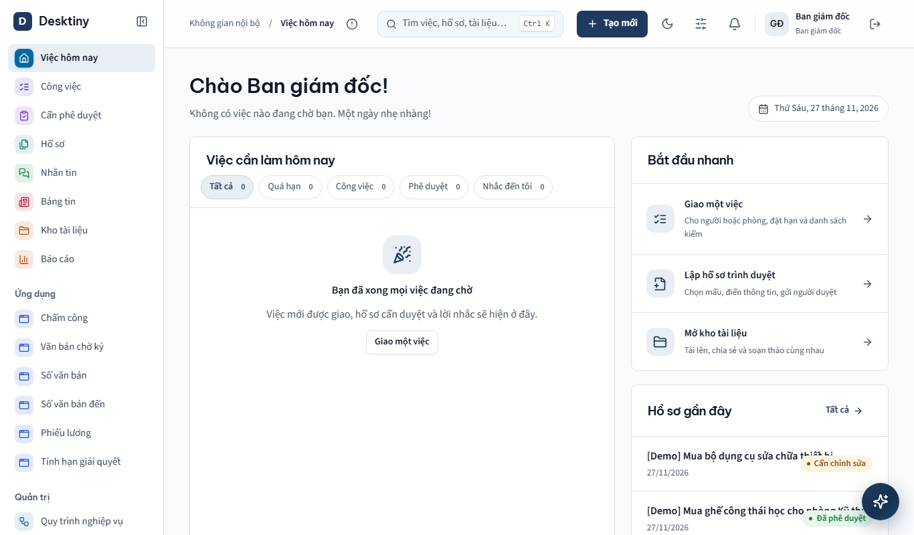
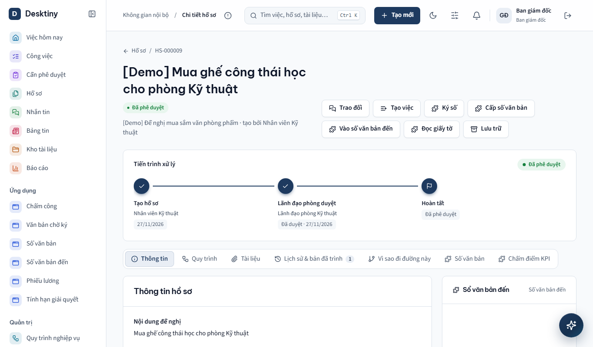
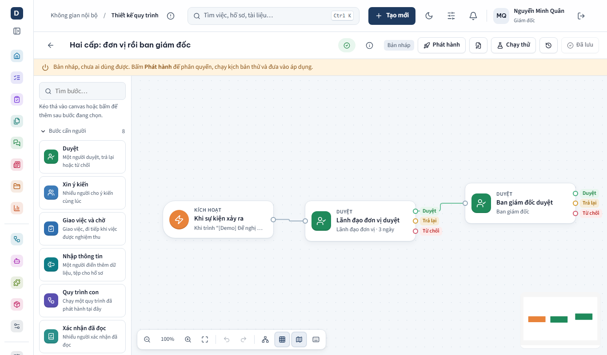
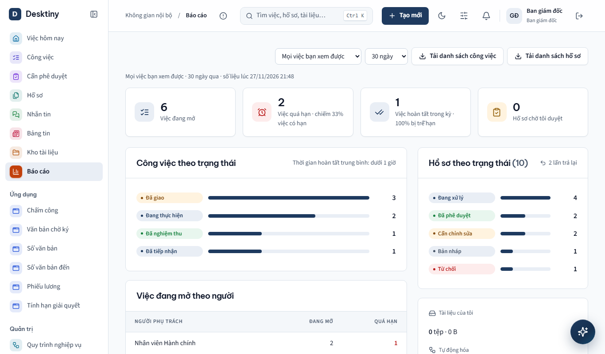
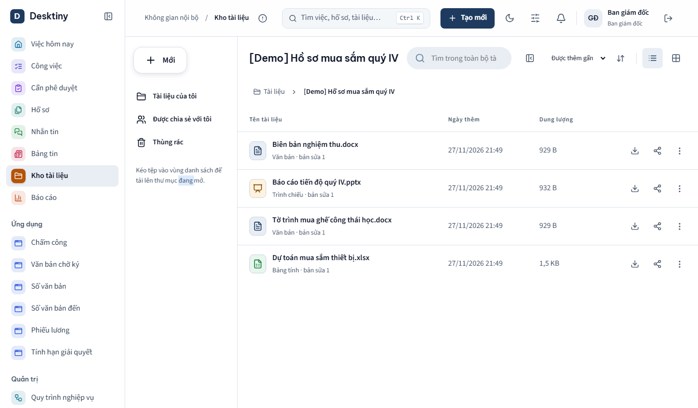
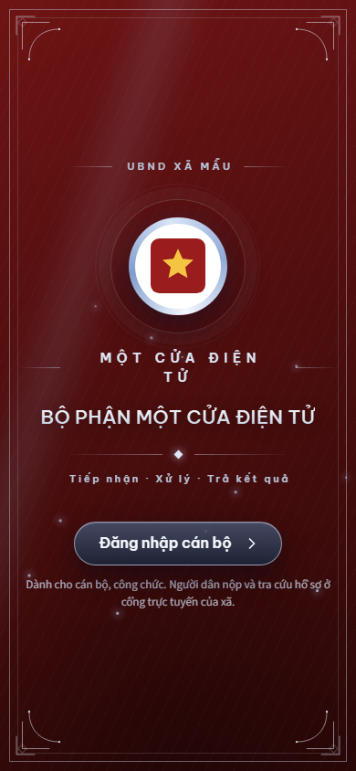
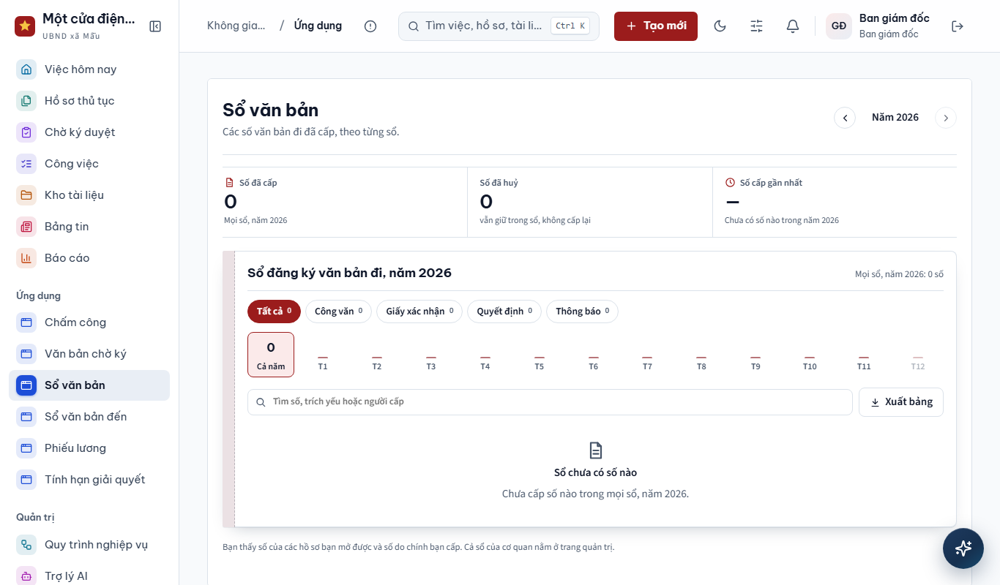

# Desktiny

**An open-source digital office for public agencies and businesses: task assignment, case submission and
approval, self-designed workflows and documents on one shared Core, extended to new lines of business by
installing a package.**

[](https://github.com/Dking2007/DXOS_Desktiny/releases)
[](LICENSE)
[](https://github.com/Dking2007/DXOS_Desktiny/actions/workflows/ci.yml)
[](https://api.reuse.software/info/github.com/Dking2007/DXOS_Desktiny)

*Desk + destiny.* Former name: DX Workspace; the internal name in code, databases and containers is still
`dx_workspace` / `dx-workspace`. Tiếng Việt: [README.md](README.md). The user interface is in Vietnamese only.

> This is a pilot release. The Compose setup in this repository is a development configuration, not a production
> one. Acceptance results and the steps that still need real services are in [docs/acceptance.md](docs/acceptance.md).

## Problem and solution

When every department runs its own software, data becomes **islands**: accounts, cases, files and processing
history are scattered, hard to look up and hard to connect. Putting everything into one monolith makes it hard to
change: each new line of business means a rewrite and easy lock-in to one vendor. Desktiny separates a **shared
headless Core** (identity, data, files, workflow, audit log) from the applications that run on it. Adding a new
line of business means **installing a package**, not rewriting the system.

## Try it

You need Docker Compose v2, Python 3.13 and a free port `8080`. Run from the repository root:

```bash
python scripts/bootstrap.py
docker compose --env-file .env -f infra/compose/compose.yaml --profile workspace up --build -d
python scripts/seed.py --confirm-demo
```

Open <http://localhost:8080/>. Trial accounts are in `infra/identity/generated/demo-credentials.txt` on your
machine: bootstrap generates random passwords locally, and the repository contains no fixed passwords. The seed
creates labelled synthetic data. To enable ONLYOFFICE, change the port or run only the Core, see
[Installation](#installation).

## Main features

| What you need to do | What Desktiny offers |
|---|---|
| Assign tasks and follow them to completion | Assign to a person or a unit; subtasks, checklists; returning, reporting a blocker or changing a deadline all require a reason and are recorded in the history. List, Kanban and by-deadline views; the home page is *Today's to-do list* |
| Submit and approve cases | Forms with fields shown or hidden by condition; approve, return, reject, parallel consultation; time-limited approval delegation; withdraw a case while no one has decided yet; the *Workflow* tab shows who the case is waiting on |
| Design workflows without writing code | Drag-and-drop canvas designer: conditions, waits, notifications, task creation, webhooks, approval steps. Test runs with sample data, replay each run on the canvas; cases follow the published workflow version |
| Manage documents | Document store with folders, sharing inherited through folders, versions, labels, copies; view PDF, images and video inside the app; open Office files with ONLYOFFICE (optional) |
| Communicate, search and report | Direct, group and department-channel messaging with images, video and files; organisation-wide or department news feed; global search that matches without Vietnamese diacritics ("bao cao" finds "Báo cáo") and returns only what the searcher may see; reports on overdue tasks and cases by status, CSV export |
| AI assistance (optional, off by default) | An assistant that answers from a knowledge base entered by administrators; 19 AI features switched on one by one (read documents to pre-fill forms, summarise cases, draft administrative documents per Decree 30/2020, semantic search…). AI only suggests; it never submits, approves or sends anything by itself. Requires an AI service configured by the organisation |

<p>
  
  
</p>
<p>
  
  
</p>
<p>
  
  
</p>

Full description of each feature and its current scope (in Vietnamese): [docs/tinh-nang.md](docs/tinh-nang.md).
AI features: [docs/ai-features.md](docs/ai-features.md).

## Expansions

The [Desktiny Expansion Pack](https://github.com/Dking2007/Desktiny_expansion_pack) repository contains
**expansions**: each one is a [UI pack](docs/packs.md) (wording, colours, workflows, forms, assistant knowledge) plus
[plugins](docs/plugins.md). An administrator installs the `.zip` files under **Quản trị › Gói giao diện** (Admin ›
UI packs) and **Quản trị › Plugin** (Admin › Plugins) to switch Desktiny to another line of business without
changing Core code. Connected plugins run on a separate plugin server (a Docker Compose setup is included in that
repository).

| Expansion | For | Bundled plugins |
|---|---|---|
| **Một cửa cấp xã** (commune one-stop shop) | The one-stop-shop desk of a commune People's Committee: civil status, certification, mediation procedures | Document register, Digital signing, Online intake, Deadline calculator, Document reader |
| **Nhân sự doanh nghiệp** (company HR) | HR departments: request workflows, policies for the assistant | GPS timekeeping, Payroll and KPI, Record deadline reminders |
| **Văn thư – điều hành** (clerical and executive office) | Clerical office: incoming documents, outgoing documents, archiving | Incoming document register; shares Document register, Digital signing, Deadline calculator |

These are samples: agency names are fictitious, deadlines and amounts are illustrative only, and digital signing is
simulated. **Compatibility:** expansion pack 1.1.0 requires Desktiny **3.1.0** or later.



## Architecture

Built with **FastAPI + Vue 3 / TypeScript**, following the two-tier model of the OLP PMNM 2026 brief (DX-OS
Open-Core):

| Tier | Components | Owns |
|---|---|---|
| Tier 1 — headless Core (no UI, API only) | `core-api` (FastAPI), `core-worker`, Keycloak, Nginx API gateway, PostgreSQL, RustFS, Valkey | Principals/ACL, schemas/records, storage/versions, workflow, audit |
| Tier 2 — applications with a UI | Workspace: `workspace-api`, `workspace-worker`, Vue web app | Organisation, Drive, forms, cases, submissions, decisions |
| Tier 2 — technical admin tool | Core admin (`apps/core-admin`, `/console/`) | Just a client of the Core API, holds no Core logic |
| Optional integration | ONLYOFFICE Docs | Editor runs separately |

The Core serves no UI pages: everything goes through the `/core/v1/` API (OpenAPI at `/core/v1/docs`). No ORM or SQL
is shared across databases; the Core keeps serving other clients when Workspace is off (for example
[`examples/core-client`](examples/core-client)). In the brief's H-P-D-I groups, Workspace covers **H** (tasks,
communication), **P** (cases, approvals, workflows), **D** (reports, partly) and **I** (optional AI features, off
by default). Details: [docs/architecture.md](docs/architecture.md).

## Installation

Full guide (Ubuntu/Windows, Docker and local runs, in Vietnamese): [docs/installation.md](docs/installation.md).
Building from source and installing with `make`: [BUILD.md](BUILD.md).

<details>
<summary>Change the port, enable ONLYOFFICE, run only the Core</summary>

- **Change the port:** run bootstrap from the start with `python scripts/bootstrap.py --base-url http://localhost:8090`.
  Bootstrap refuses to overwrite an existing configuration; do not use it to provision production.
- **ONLYOFFICE:** set `ONLYOFFICE_ENABLED=true` in `.env`, then run
  `docker compose --env-file .env -f infra/compose/compose.yaml --profile workspace --profile office up -d`.
  Wait for Document Server to be ready, then open documents from the document store. While it is off, the editor
  does not work.
- **Core only:** `docker compose --env-file .env -f infra/compose/compose.yaml --profile core up --build -d`, then
  open `/console/`. The `core-example` client uses the `equipment` namespace, with secret `CORE_EXAMPLE_CLIENT_SECRET`
  in `.env`.

</details>

<details>
<summary>Local development and tests</summary>

Requires Python 3.13 and Node.js 22. The backends still need PostgreSQL, Keycloak and S3 for real integrations.

```bash
python -m venv .venv            # then activate: .venv/Scripts/activate (Windows) or .venv/bin/activate
python -m pip install -r requirements-dev.txt
npm ci
# Run each backend from its service directory, with its own DATABASE_URL:
#   services/core-api:      python -m alembic upgrade head && python -m uvicorn dx_core.main:app --port 8001
#   services/workspace-api: python -m alembic upgrade head && python -m uvicorn dx_workspace.main:app --port 8002
npm run dev --workspace apps/workspace-web
```

```bash
python -m ruff check packages services scripts tests examples infra
python -m pytest -q
npm run lint && npm run typecheck && npm run test && npm run build
```

Test doubles check logic but do not replace acceptance of PostgreSQL locking, SSO, real Office or a clean install.
Details: [docs/installation.md](docs/installation.md), [docs/acceptance.md](docs/acceptance.md).

</details>

## Limitations

- **Pilot:** the Compose setup in the repository is a development configuration, not production; no performance or
  RPO/RTO commitments until measured.
- **One organisation** per deployment; no multi-organisation SaaS, and a person cannot belong to several units.
- **No legally valid digital signature.** Approval rights and the audit log do not replace digital signatures; the
  Digital signing plugin in the one-stop-shop expansion is a simulation.
- **No native mobile app**; on phones, use the web app.
- **No antivirus/malware scanning** of uploaded files yet; only format, content signature and size checks.
- **AI needs an external service** (Claude, OpenAI, Gemini, DeepSeek) or a self-hosted AI server (Ollama, vLLM)
  configured by the organisation. Tested with fake services and one real run against Ollama (31 Oct 2026); not yet
  tried with real Claude, OpenAI or Gemini.
- Messaging and notifications update by polling, not WebSocket; tasks have no Gantt or month calendar; automations
  have no loop node or OAuth2 connectors. Scope of each feature: [docs/tinh-nang.md](docs/tinh-nang.md).

## Documentation

Most documents are in Vietnamese.

- [Installation](docs/installation.md) · [Building](BUILD.md) · [Operations, backup, restore](docs/operations.md) ·
  [Security](docs/security.md)
- [Feature details](docs/tinh-nang.md) · [AI features](docs/ai-features.md) · [Demo script](docs/demo.md)
- [Business workflows, test runs and tracing](docs/process-packages.md) · [UI packs](docs/packs.md) ·
  [Plugins](docs/plugins.md)
- [Architecture](docs/architecture.md) · [Original design](docs/design/Thiet_ke_DX_Workspace_FastAPI_Vue3.md) ·
  [Third-party inventory](docs/third-party-inventory.md)
- [CHANGELOG](CHANGELOG.md); the current release is **V3.1 (3.1.0)**. V3 vs V2: [docs/V3_CHANGES.md](docs/V3_CHANGES.md);
  V2 vs V1: [docs/V2_CHANGES.md](docs/V2_CHANGES.md).

## Mapping to the competition brief

Requirement-by-requirement mapping of the OLP PMNM 2026 brief to the source code:
[docs/doi-chieu-de-thi.md](docs/doi-chieu-de-thi.md). Self-review against the PoF criteria:
[SELF_REVIEW.md](SELF_REVIEW.md).

## Building, releases and contributing

- Bugs and suggestions: <https://github.com/Dking2007/DXOS_Desktiny/issues>.
- Releases (`.tar.gz` with `SHA256SUMS`): <https://github.com/Dking2007/DXOS_Desktiny/releases>.
- How to contribute: [CONTRIBUTING.md](CONTRIBUTING.md), [CODE_OF_CONDUCT.md](CODE_OF_CONDUCT.md); reporting
  security issues: [SECURITY.md](SECURITY.md).

### Upstream contributions to open source

Actual status at the time of writing (30 Oct 2026); steps, links and outcomes are in
[docs/contribution-log.md](docs/contribution-log.md).

| Work | Receiving project | Status |
|---|---|---|
| Add 2 missing notes to the "Migrating to 26.7.5" section of the upgrade guide | Keycloak: issue [#53650](https://github.com/keycloak/keycloak/issues/53650), PR [#54464](https://github.com/keycloak/keycloak/pull/54464) | Submitted 30 Oct 2026, awaiting maintainer review (not merged) |
| Plugin that checks Vietnamese administrative document format per Decree 30/2020/NĐ-CP ([`plugins/vn-document-format`](plugins/vn-document-format)) | ONLYOFFICE marketplace: [PR #730](https://github.com/ONLYOFFICE/onlyoffice.github.io/pull/730) | Submitted 30 Oct 2026, CLA signed, awaiting maintainer review |
| `dx-flowkit`: validate and dry-run JSON workflow graphs ([`packages/flowkit`](packages/flowkit)) | Standalone package extracted from Desktiny | Not published outside this repository (not on PyPI) |
| Volume permission error when running RustFS as non-root | RustFS [#8992](https://github.com/rustfs/rustfs/issues/8992) | Reviewed, not submitted: the maintainers fixed it themselves |

## License

Code written by the project is released under the **Apache License 2.0** (SPDX: `Apache-2.0`).

- **Why Apache-2.0:** a permissive OSI license with a patent grant, compatible with every library the project uses
  (MIT/BSD/Apache/MPL/PSF/OFL; psycopg LGPL-3.0 is used as a dynamically linked library, unmodified). Copyleft
  services (ONLYOFFICE AGPL-3.0, optional) run separately over HTTP and are not linked into the code.
- Full text: [LICENSE](LICENSE) and [LICENSES/Apache-2.0.txt](LICENSES/Apache-2.0.txt) following the
  [REUSE](https://reuse.software/) standard. Each code file carries an `SPDX-License-Identifier` header; files that
  cannot carry a header are declared in [REUSE.toml](REUSE.toml). Check with `reuse lint`.
- External components (ONLYOFFICE, RustFS, Keycloak…) keep their own licenses: [THIRD_PARTY.md](THIRD_PARTY.md),
  [NOTICE](NOTICE). When distributing, review artifacts, notices, source offers and trademarks for the exact release.
