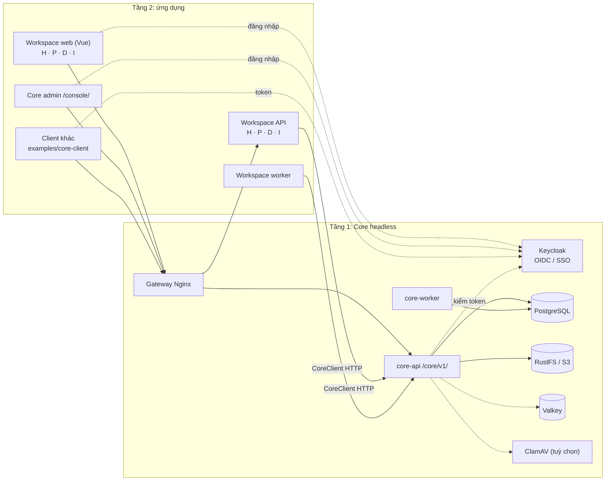

# Kiến trúc và quyền sở hữu dữ liệu

## Hai tầng độc lập

- **Tầng 1:** Keycloak, gateway, Core API/worker, private object storage và Core admin.
  Core sở hữu generic principal/resource/grant, schema/record, file/version và workflow.
- **Tầng 2:** Workspace API/worker và web Vue. Workspace sở hữu tổ chức, quan hệ phòng
  ban, Drive hiển thị, biểu mẫu, hồ sơ, submission và quyết định phê duyệt.
- PostgreSQL chạy chung instance ở cấu hình dev nhưng ba database và DB user tách
  biệt: `dx_core`, `dx_workspace`, `dx_identity`. Không có FK/SQL xuyên tầng.
- Workspace chỉ truy cập Core qua HTTP `CoreClient`. Code dùng chung chỉ là thư viện
  kỹ thuật; không chia sẻ ORM nghiệp vụ. Core phải chạy được khi Workspace dừng.

## Ranh giới Core headless

Core (`services/core-api`) chỉ phục vụ API dưới `/core/v1/`; không trả HTML nghiệp vụ, không
có template hay tệp tĩnh. Ứng dụng quản trị `/console/` (`apps/core-admin`) là một client
riêng, đăng nhập qua Keycloak rồi gọi API Core như mọi client khác. Đường `/core/v1/docs` và
`/core/v1/openapi.json` là tài liệu OpenAPI do FastAPI tự sinh; đó là tài liệu API, không phải
giao diện nghiệp vụ. Mã hiện chưa có cờ cấu hình để tắt hai đường này. Bảng đối chiếu với đề
OLP 2026 ở [doi-chieu-de-thi.md](doi-chieu-de-thi.md).

Mũi tên liền là lời gọi dữ liệu; nét đứt là xác thực hoặc thành phần tuỳ chọn. Workspace dùng
database riêng và không truy cập PostgreSQL của Core.

## Nguồn sự thật

| Dữ liệu | Nơi sở hữu |
|---|---|
| Xác thực/SSO | Keycloak |
| Schema và payload live/version | Core |
| Bytes, hash, immutable file version | Core + private S3 |
| Tên thư mục/file hiển thị, ngữ cảnh chia sẻ | Workspace |
| Snapshot đã trình và quyết định nghiệp vụ | Workspace |
| Graph/run/node/human task generic | Core |
| Trạng thái phục hồi và outbox | DB riêng của từng service |

Submission ghim payload revision, snapshot và file version; chỉnh sửa nháp sau đó
không làm đổi lịch sử đã trình. Quyết định được ghi ở Workspace trước khi hoàn tất
human task Core. Người dùng không được gọi Core để tự làm hồ sơ `approved`.

## Định danh và phiên

Browser dùng BFF cookie phiên, không giữ access/refresh token trong localStorage.
OIDC code flow dùng state/nonce/PKCE, issuer và audience được kiểm tra ở backend.
Core/Workspace không tin request chỉ vì đã qua Nginx. Token thay mặt người dùng
phải có audience Core và vẫn chịu ACL; service client không phải cách bỏ quyền.

Namespace lấy từ claim `application`, không nhận tùy ý từ body. Core admin dev dùng
namespace `workspace`; client `core-example` dùng `equipment` để chứng minh cách ly.
`technical_admin` không tự đồng nghĩa được đọc mọi hồ sơ/tài liệu nghiệp vụ.

## Tính bền vững

Worker phiên bản đầu poll PostgreSQL và đối soát workflow runtime trực tiếp. Valkey
được cấp trong Compose để mở rộng queue/cache nhưng **không phải nguồn lịch sử**
và không được xem là một Celery runtime đã tích hợp. Core ghi outbox và giữ pending;
**chưa triển khai external event dispatcher hay trigger giao event qua broker**.
Outbox pending không được trình bày như đã delivery thành công. Runtime DB,
khóa/idempotency và checkpoint là cơ sở phục hồi. Khi send có thể đã thành công nhưng ACK bị mất, phải dedupe hoặc đối soát;
không tuyên bố exactly-once với dịch vụ bên ngoài.

Nginx phân giải upstream qua Docker DNS tại request-time. Do đó profile `core`
không cần có Workspace hoặc ONLYOFFICE vẫn khởi động được; tuyến tới module chưa
bật sẽ không hoạt động, không có mock thay thế.

## Quy ước phụ thuộc trong Workspace API

Các module trong `services/workspace-api/src/dx_workspace` phụ thuộc theo một chiều, không vòng:
`schemas`, `models`, `config`, `core_client` ở dưới cùng; `policies` và `services` dùng chung cho
các module tính năng (`tasks`, `messaging`, `feed`, `packages`, `automations`...); `routers` và
`main` ở trên cùng. Hàm cần cho nhiều module tính năng (ví dụ `validate_payload`, `membership`)
đặt ở tầng dưới thay vì import ngược lên bằng import trong hàm. `tests/test_boundaries.py` kiểm
vòng phụ thuộc, và kiểm Core không import Workspace (ngược lại cũng vậy).

## Các lựa chọn giới hạn có chủ ý

Một tổ chức mỗi deployment; chưa SaaS đa tenant. Phê duyệt tuần tự/điều kiện/trả
lại, hoặc theo quy trình hồ sơ vẽ trên canvas (DAG; xin ý kiến song song cần tất cả hoặc một
người đồng ý); chưa quorum. Quy trình canvas chạy bằng engine luồng của Workspace worker, mỗi bước
cần người quyết định vẫn là một human task Core (xem `process-packages.md`). UI là danh sách việc cần xử lý và báo cáo cơ bản, không phải
dashboard phân tích tùy chỉnh. Workspace đã có giao việc, nhắn tin (polling REST, chưa
WebSocket), bảng tin, tìm kiếm, ủy quyền và tự động hóa dạng canvas kéo-thả; mô tả và giới
hạn từng phần ở README. Chưa có AI/OCR/RAG.
Các giới hạn thực tế của code và kiểm thử được ghi tại `acceptance.md` và README.
